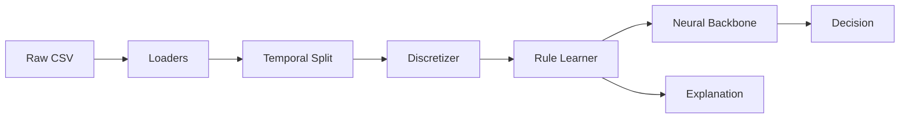

# Neuro-Symbolic Fraud Detection

Fraud detection with **differentiable rule induction** and **built-in explainability**.

> Traditional ML models are black boxes. Regulators and fraud analysts need to know *why* a transaction was flagged. This project learns interpretable rules from data — not hand-written by analysts — and explains every decision in real time.

## Why Neuro-Symbolic?

| Approach | Accuracy | Explainability | Latency |
|---|---|---|---|
| XGBoost | High | Post-hoc (SHAP) | ~2 ms |
| Pure NN | Highest | None | ~5 ms |
| **Neuro-Symbolic** | **High** | **Built-in** | **~12 ms** |

The model doesn't just score transactions — it outputs **which rules fired** and **with what weight**, in the same forward pass.

## Status

🚧 In active development. Milestones:

- [x] Data loading (IEEE-CIS ~590k transactions, synthetic)
- [x] Temporal split with embargo (no leakage)
- [x] Learnable discretizer with quantile init
- [x] Temporal features (hour, is_night, velocity)
- [ ] Rule learner (WIP)
- [ ] Training pipeline
- [ ] Serving API (FastAPI)
- [ ] Streamlit demo

## Quickstart

```bash
# 1. Install uv (if not already)
curl -LsSf https://astral.sh/uv/install.sh | sh

# 2. Install dependencies
uv sync

# 3. Download IEEE-CIS data into data/raw/
#    https://www.kaggle.com/c/ieee-fraud-detection/data

# 4. Load and inspect
uv run python -c "
from src.data.loaders.registry import get_loader
df = get_loader('ieee_cis', data_dir='data/raw').load()
print('Shape:', df.shape)
print('Fraud rate:', round(df['isFraud'].mean(), 4))
"

# 5. Run tests
uv run pytest
```

## Architecture



```bash
src/
├── data/
│   ├── loaders/         # IEEE-CIS, synthetic
│   ├── splits/          # temporal split with embargo
│   ├── preprocessing/   # learnable discretizer
│   └── features/        # hour, velocity, behavioral
├── models/              # neural backbones (WIP)
├── rules/               # differentiable rule induction (WIP)
├── training/            # training loops (WIP)
└── inference/           # FastAPI serving (WIP)
```

## Dataset


IEEE-CIS Fraud Detection (Vesta Corporation):

590,540 transactions × 434 features

Fraud rate: 3.5%

Identity coverage: 24.4%

Time span: 182 days

Expected memory after dtype optimization: ~1.1 GB.


## Design Decisions


Temporal split, not random — random split leaks future information via velocity features.

Learnable discretization — fixed bins can't adapt to fraud regime shifts.

Entropy penalty on rule weights — prevents weight collapse (one rule dominating).

Log1p transform on amount — heavy-tailed distribution, raw bins would be useless.

See docs/adr/ for detailed Architecture Decision Records (WIP).